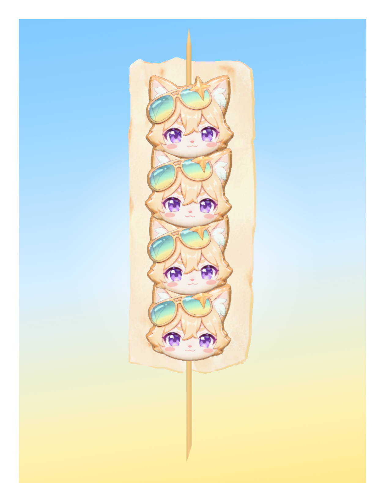

# 浪浪仙冰糖葫芦串串

一个纯静态的 3D 小游戏：把浪浪仙糖球一颗颗串上竹签，最后铺上奶皮，360° 转着看你的成品。



## 玩法

- 点「串萌物」：浪浪仙糖球从签尖滑下串到签上，最多 4 颗；
- 点「铺奶皮」：奶皮最后加——没串萌物时会提示，串满后铺奶皮收尾；
- 完成后自动弹出成品弹窗，可保存图片到手机/电脑；
- 拖动画面可 360° 旋转冰糖葫芦，完成后再做一串。

## 技术说明

- 纯静态站点（HTML + CSS + JS），无需构建、无后端；
- 3D 模型由 Blender 建模导出 GLB，页面内使用 Three.js（已本地内置，无 CDN 依赖）渲染与交互；
- 支持手机竖屏/横屏、平板、桌面浏览器，触屏与鼠标均可。


## 文件结构

```
index.html      入口页面
style.css       样式（蓝黄渐变、按钮、弹窗、加载页）
main.js         游戏逻辑（串签、奶皮、360° 旋转、保存图片）
vendor/         Three.js 本地内置（含 OrbitControls/GLTFLoader）
assets/
  model/        Blender 建模导出的冰糖葫芦 GLB
  ui/           按钮与弹窗图片素材
  audio/        背景音乐与完成音效
```

## 素材版权

游戏内美术素材（浪浪仙形象、糖球、奶皮、成品图）为本项目生成/用户提供，仅用于本游戏演示。请勿用于商业用途。
